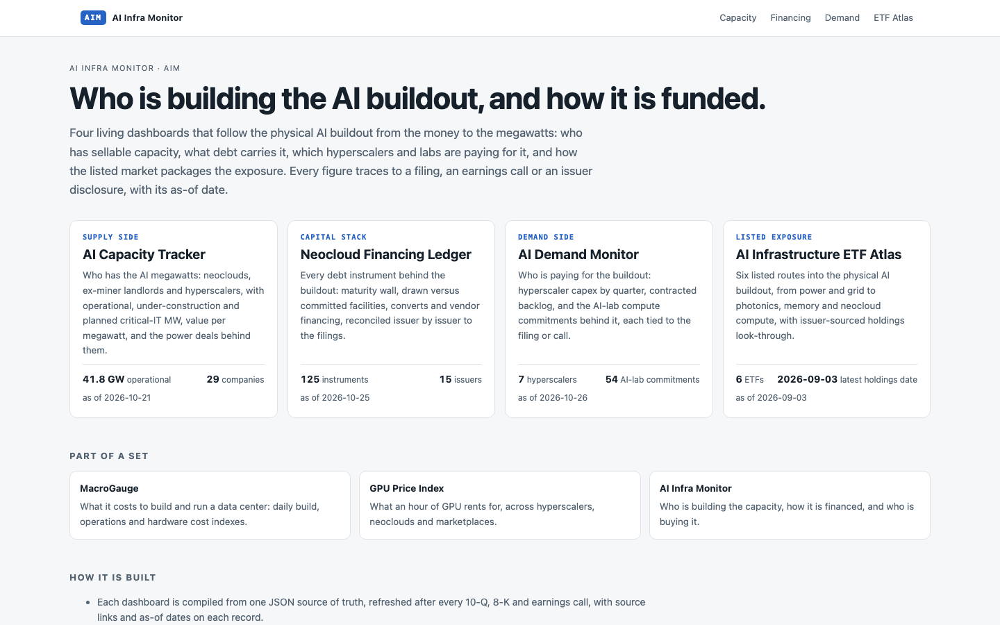
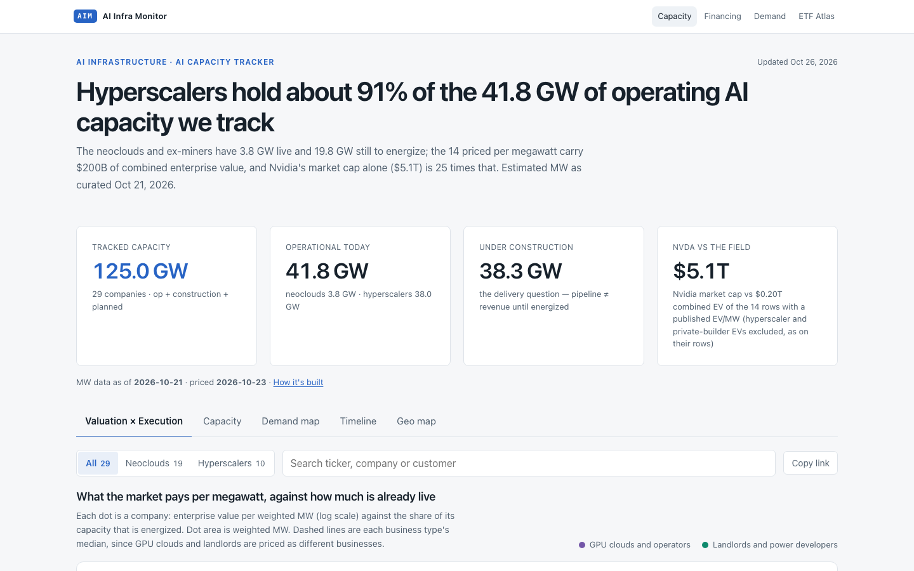
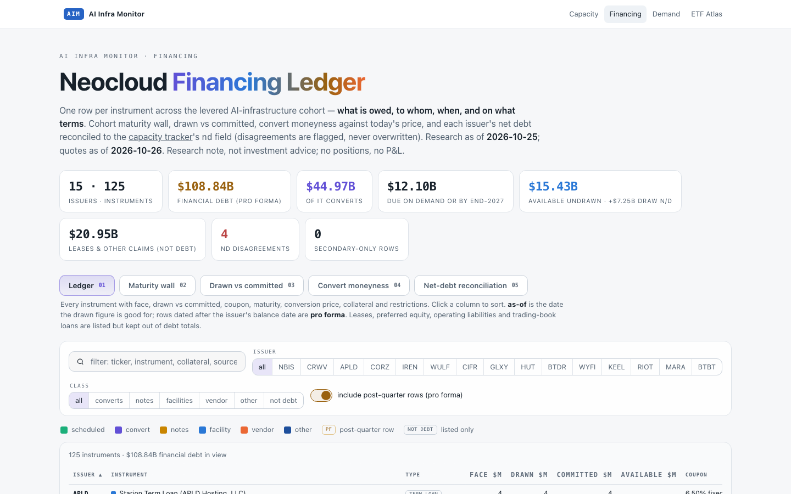
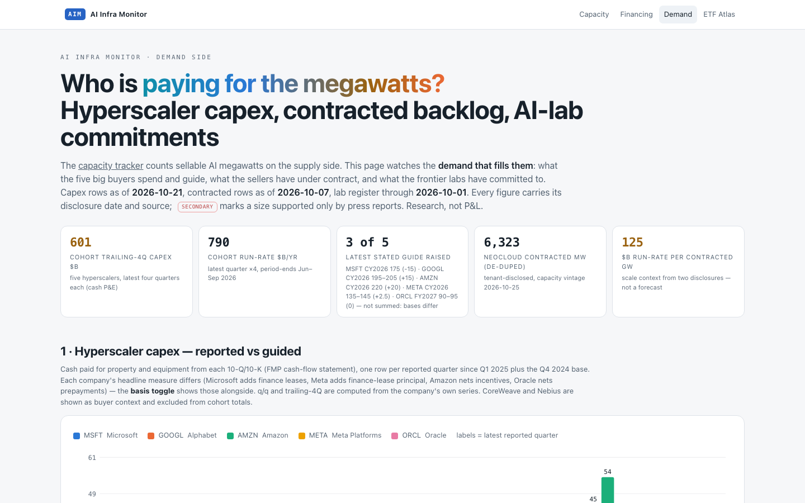
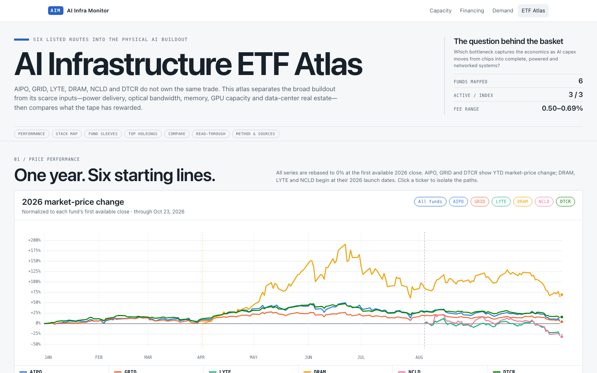

# AI Infra Monitor

**Living dashboards on the AI infrastructure buildout: who is building the capacity, how it is
financed, who is paying for it, and how to own it in listed markets. Compiled from SEC filings and
company disclosures.**

[](https://github.com/ewyluda/ai-infra-monitor/actions/workflows/ci.yml)
[](LICENSE)

**[Live site →](https://ewyluda.github.io/ai-infra-monitor/)** · Also by the author:
[MacroGauge](https://macrogauge-cloudten.vercel.app/datacenter) (data center cost indexes) ·
[GPU Price Index](https://ewyluda.github.io/gpu-price-index/) (compute rental prices)



## The dashboards

| Dashboard | Side of the trade | What it tracks | Data |
| --- | --- | --- | --- |
| [AI Capacity Tracker](https://ewyluda.github.io/ai-infra-monitor/neocloud-capacity-tracker.html) | Supply | Who has the AI megawatts: neoclouds, ex-miner landlords and hyperscalers, with operational, under-construction and planned critical-IT MW, value per megawatt, and the power deals behind them. Same data as [MacroGauge's capacity page](https://macrogauge-cloudten.vercel.app/capacity). | [JSON](site/data/capacity.json) |
| [Neocloud Financing Ledger](https://ewyluda.github.io/ai-infra-monitor/neocloud-financing-ledger.html) | Capital stack | Every debt instrument behind the buildout: maturity wall, drawn versus committed facilities, converts and vendor financing, reconciled issuer by issuer to the filings. | [JSON](site/data/neocloud-financing-ledger.json) |
| [AI Demand Monitor](https://ewyluda.github.io/ai-infra-monitor/ai-demand-monitor.html) | Demand | Hyperscaler capex by quarter, contracted backlog, and the AI-lab compute commitments behind it, each tied to the filing or call. | [JSON](site/data/ai-demand-monitor.json) |
| [AI Infrastructure ETF Atlas](https://ewyluda.github.io/ai-infra-monitor/ai-infrastructure-etf-atlas.html) | Listed exposure | Six listed routes into the physical buildout, from power and grid to photonics, memory and neocloud compute, with issuer-sourced holdings look-through. | [JSON](site/data/ai-infrastructure-etfs.json) |









## Data sources

- **Capacity:** [MacroGauge](https://macrogauge-cloudten.vercel.app/capacity)'s published capacity
  dataset, rendered as published, so both sites show the same figures. It is curated from filings,
  with each figure's source and date in the JSON.
- **Financing and demand:** 10-Ks, 10-Qs, 8-Ks, investor presentations and earnings calls. Each
  figure carries its source and date in the page and in the JSON.
- **ETF holdings:** each issuer's published holdings file.
- **Market prices:** equity quotes and market caps from [Financial Modeling Prep](https://site.financialmodelingprep.com/);
  ETF price history from Nasdaq. Every price-derived figure shows its quote date.

[`site.json`](site/site.json) lists every page with its as-of date and market-data source.

## How it works

The capacity page renders MacroGauge's published capacity dataset. The other dashboards are
maintained in a private research repository, where each one has a single JSON source of truth, a refresh script, and a contract check that fails when the page and the data
disagree. A tested export step builds this site from those sources:

1. Copies the published pages and nothing else, and rewrites every link that pointed into the
   private repository.
2. Applies the shared light brand and a per-page chart palette checked for color-vision
   separation.
3. Scans the result for private paths and terms and for broken links, and fails the build on
   any hit.
4. Publishes each dashboard's JSON next to it under [`site/data/`](site/data/).

Pages are static HTML with the data embedded. There are no runtime fetches and no API keys in
the site.

**Refresh cadence:** capacity cohorts, financing events and demand items are curated by hand
after each filing or print. Quotes are refreshed with each export, and every page shows its
as-of date.

## Checks

CI runs on every push:

```bash
python3 tools/check_site.py site                                  # relative links resolve, JSON parses
npx --yes html-validate@11.16.2 --preset standard site/*.html    # HTML validates
```

To preview locally:

```bash
python3 -m http.server 8765 --directory site
```

## License

Code is [MIT](LICENSE). Figures are drawn from public filings, issuer disclosures and the market
data vendors named above, and remain those publishers' information. This is research and analysis
only, not investment advice.
