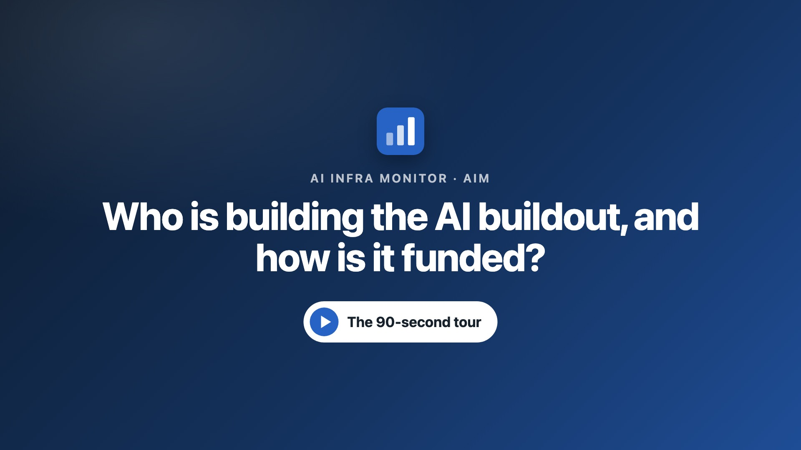
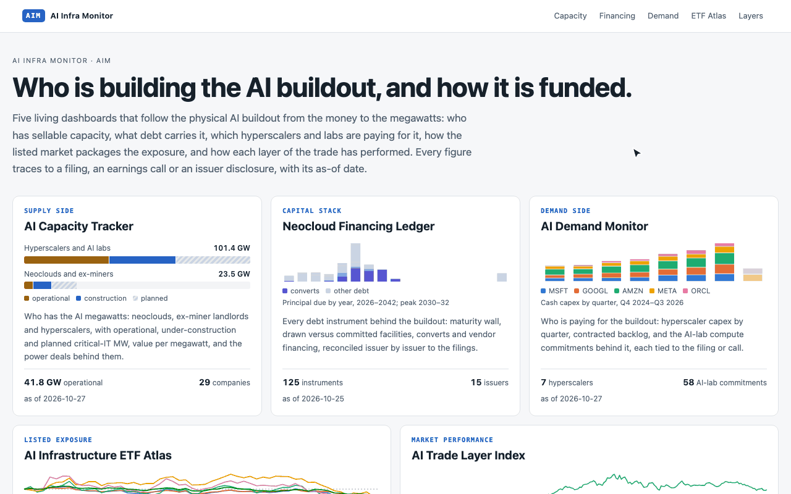
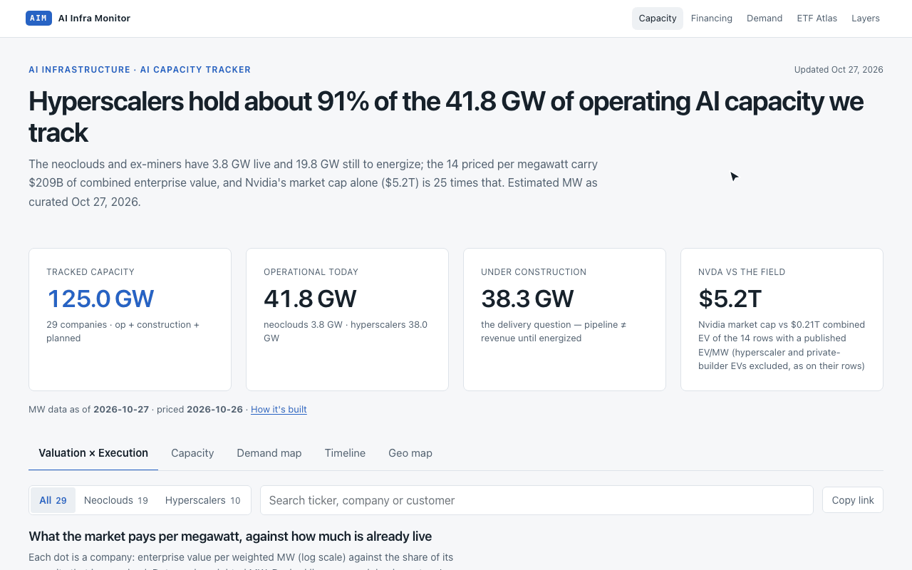
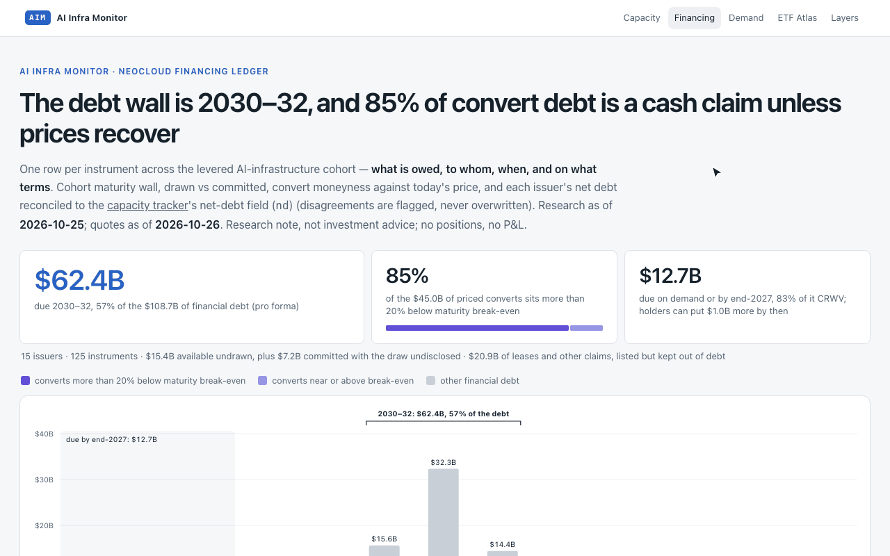
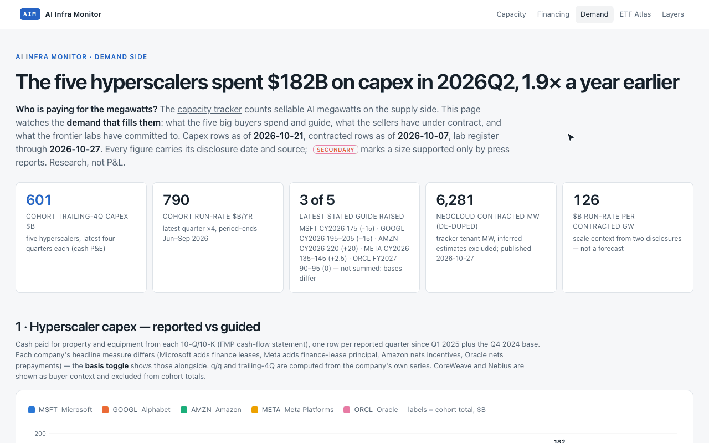
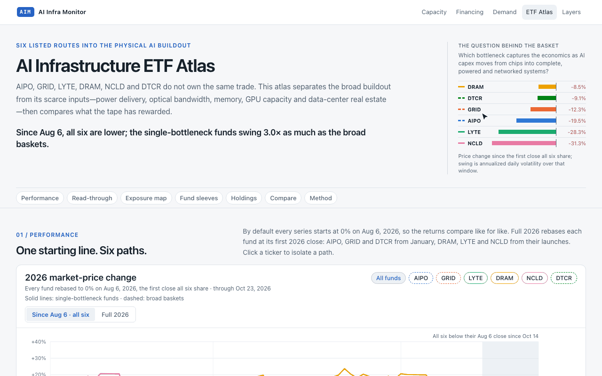
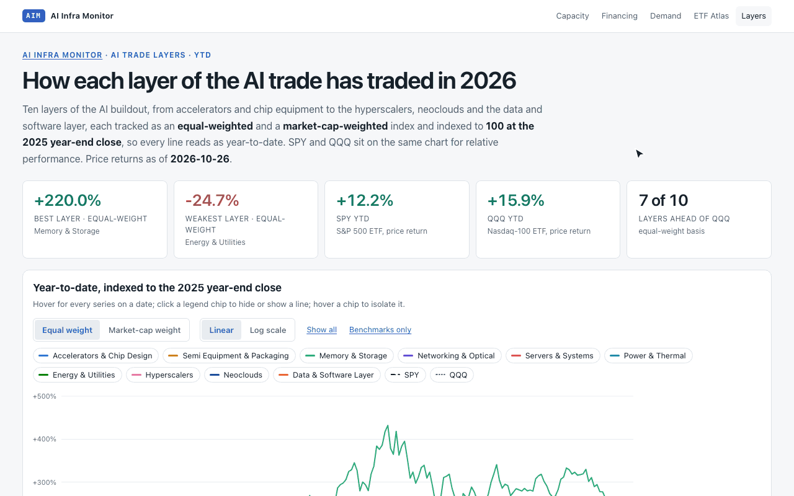

# AI Infra Monitor

**Living dashboards on the AI infrastructure buildout: who is building the capacity, how it is
financed, who is paying for it, and how to own it in listed markets. Compiled from SEC filings and
company disclosures.**

[](https://github.com/ewyluda/ai-infra-monitor/actions/workflows/ci.yml)
[](LICENSE)

**[Live site →](https://ewyluda.github.io/ai-infra-monitor/)** · Also by the author:
[MacroGauge](https://macrogauge-cloudten.vercel.app/datacenter) (data center cost indexes) ·
[GPU Price Index](https://ewyluda.github.io/gpu-price-index/) (compute rental prices)

<a href="https://ewyluda.github.io/ai-infra-monitor/assets/aim-tour.mp4"></a>



## The dashboards

Five pages, one per side of the trade. Every figure carries its source and as-of date.

| Dashboard | Side of the trade | The question it answers |
| --- | --- | --- |
| [AI Capacity Tracker](https://ewyluda.github.io/ai-infra-monitor/neocloud-capacity-tracker.html) | Supply | Who has the AI megawatts? |
| [Neocloud Financing Ledger](https://ewyluda.github.io/ai-infra-monitor/neocloud-financing-ledger.html) | Capital stack | What debt carries the build, and when is it due? |
| [AI Demand Monitor](https://ewyluda.github.io/ai-infra-monitor/ai-demand-monitor.html) | Demand | Who is paying for the megawatts? |
| [AI Infrastructure ETF Atlas](https://ewyluda.github.io/ai-infra-monitor/ai-infrastructure-etf-atlas.html) | Listed exposure | Which fund owns which bottleneck? |
| [AI Trade Layer Index](https://ewyluda.github.io/ai-infra-monitor/ai-trade-layer-index.html) | Market performance | Which layer of the AI trade has the market rewarded this year? |

### AI Capacity Tracker

Neoclouds, ex-miner landlords, hyperscalers and AI labs, with operational, under-construction and
planned critical-IT megawatts, enterprise value per megawatt, the energization schedule by
quarter, a campus map, and the power and tenant deals behind each site. It renders
[MacroGauge's capacity dataset](https://macrogauge-cloudten.vercel.app/capacity) as published, so
both sites show the same figures.



### Neocloud Financing Ledger

One row per debt instrument across the levered AI-infrastructure cohort: what is owed, to whom,
when, and on what terms. The cohort maturity wall is split by convert moneyness against today's
price, alongside drawn versus committed facilities and each issuer's net debt, reconciled to the
capacity tracker with disagreements flagged rather than overwritten.



### AI Demand Monitor

What the five big buyers spend and guide, quarter by quarter, against what the sellers have under
contract (RPO and backlog) and the register of frontier-lab compute commitments. A cross-check
sets buyer spend against contracted neocloud megawatts. Sizes supported only by press reports are
marked as secondary.



### AI Infrastructure ETF Atlas

Six listed routes into the physical buildout, from power delivery and the grid to photonics,
memory, GPU capacity and data center real estate. Returns are compared from a common start date,
then each fund is broken down into its sleeves and top holdings from the issuer's own holdings
file, with holdings overlap set against return correlation.



### AI Trade Layer Index

Ten layers of the AI trade, from accelerators and chip equipment to the hyperscalers, neoclouds
and the data and software layer, each tracked as an equal-weighted and a market-cap-weighted
index from the 2025 year-end close and charted against SPY and QQQ. A scoreboard ranks the layers
and opens each one to its constituents.



## Data sources

- **Capacity:** [MacroGauge](https://macrogauge-cloudten.vercel.app/capacity)'s published capacity
  dataset, curated from filings, with each figure's source and date on the page.
- **Financing and demand:** 10-Ks, 10-Qs, 8-Ks, investor presentations and earnings calls. Each
  figure carries its source and date on the page.
- **ETF holdings:** each issuer's published holdings file.
- **AI trade layers:** the author's grouping of 57 stocks into ten layers.
- **Market prices:** equity quotes, daily closes and market caps from [Financial Modeling Prep](https://site.financialmodelingprep.com/);
  ETF price history from Nasdaq. Every price-derived figure shows its quote date.

[`site.json`](site/site.json) lists every page with its as-of date and market-data source.

## How it works

The capacity page renders MacroGauge's published capacity dataset. The other dashboards are
maintained in a private research repository, where each one has a single JSON source of truth, a
refresh script, and a contract check that fails when the page and the data disagree. A tested
export step builds this site from those sources:

1. Copies the published pages and nothing else, and rewrites every link that pointed into the
   private repository.
2. Applies the shared light brand and a per-page chart palette checked for color-vision
   separation.
3. Scans the result for private paths and terms and for broken links, and fails the build on
   any hit.
4. Publishes pages, not data: no JSON downloads. Every page carries the copyright line, a link
   to the [terms](https://ewyluda.github.io/ai-infra-monitor/terms.html) and the machine-readable
   text-and-data-mining reservation (`tdm-reservation` meta tag).

Pages are static HTML with the data embedded. There are no runtime fetches and no API keys in
the site.

**Refresh cadence:** capacity cohorts, financing events and demand items are curated by hand
after each filing or print. Quotes are refreshed with each export, and every page shows its
as-of date.

## Checks

CI runs on every push:

```bash
python3 tools/check_site.py site                                  # relative links resolve, no data files, TDM reservation on every page
python3 tools/check_demand.py                                    # financial calculations, capacity snapshot, source regression checks
python3 tools/check_financing.py                                 # maturity wall and net-debt calculations, audit regressions
npx --yes html-validate@11.16.2 --preset standard site/*.html    # HTML validates
```

To preview locally:

```bash
python3 -m http.server 8765 --directory site
```

## License

© 2026 Eric Wyluda. All rights reserved ([LICENSE](LICENSE)). Quote individual figures with a
citation; scraping, bulk copying and AI training or retrieval are not permitted without written
permission. The [terms of use](https://ewyluda.github.io/ai-infra-monitor/terms.html) govern the
site. The underlying facts come from public filings, issuer disclosures and the market data vendors
named above. This is research and analysis only, not investment advice.
